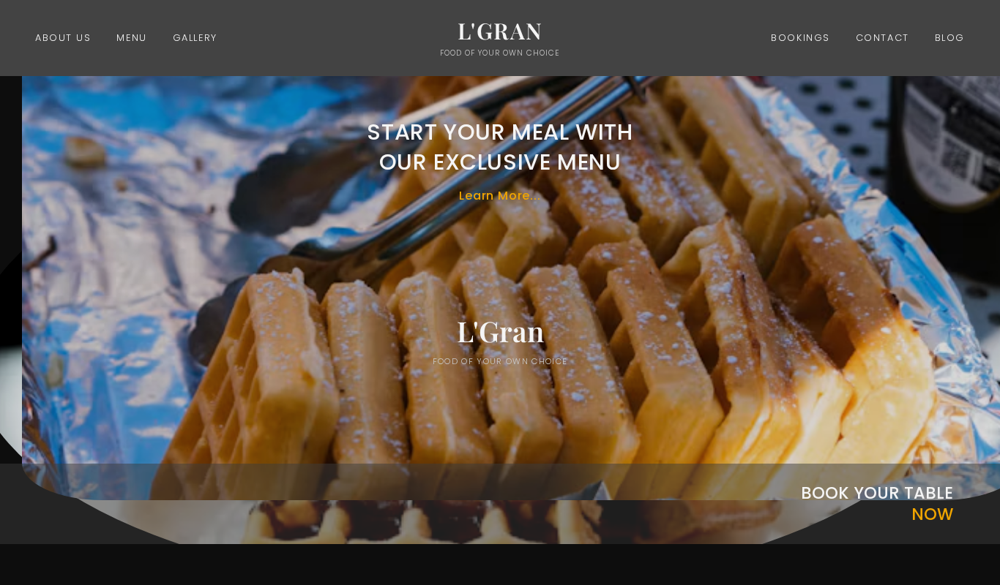

# L'Gran — PSD to HTML Food Website

Restaurant landing page converted from a PSD design to HTML & CSS.

**Live demo:** https://ammad-codes.github.io/PSD-to-HTML-Food-Of-Your-Own/

## Tech used
HTML5, CSS3

## Features
- PSD-to-HTML conversion
- Full-width hero with menu call-to-action
- Menu, gallery and table booking sections
- Responsive layout

## Author
Ammad Khan — Frontend Developer (HTML, CSS, Tailwind) · https://github.com/ammad-codes
